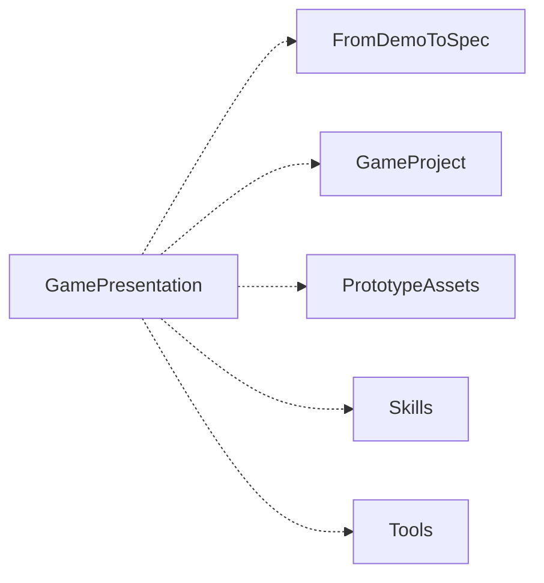

# GamePresentation


[English](README.en.md)

## 独立使用与相关模块

本仓是 GamePresentation 的独立发布内容。按下方业务入口开始，实际环境要求见模块文档与 [module.json](module.json)。AWS 与 meta 可以按需要提供跨模块协作和宿主治理，当前用户授权与已有宿主规则保持权威。

模块相关能力、数据交接和安装审阅见 [协作说明](docs/module-cooperation.md)。只读取本次任务需要的入口，用户项目、账号、资料和工具运行环境按各业务文档放在包外。

```text
python .module/module_manager.py verify
python .module/module_manager.py related
python .module/module_manager.py audit --target <workspace> --modules <related-id>
python .module/module_manager.py fetch --target <workspace> --modules <related-id> --apply
```

先审阅已有同类模块、输入输出和数据归属，再按实际需要执行获取。已有同版本模块通过身份与库存核对后复用，具体业务接线沿协作说明决定。

<!-- module-panorama:start -->


虚线表示可选协作。具体用途与接口见 module.json 和协作说明。 / Dashed edges indicate optional cooperation. See module.json and the cooperation guide.
<!-- module-panorama:end -->

游戏表现资源从用途规格、样张、生成或选型，到真实引擎接入与恢复的工作流。直接让 Agent 阅读 [workflow](workflow.md)，位图制作读 [generated-art](generated-art.md)，资产管理读 [project-assets](project-assets.md)。仅需局部修改时按实际缺口进入，不强制整套流程。

用户选择本地生图时，读[本地素材流程](local-image-workflow.md)：可选Tools统一生成/加工，再用实际尺寸审图工作台核验候选。安装不下载模型、不启动生成、不授予清理或项目采用；性能停止条件和未采用路线限制保留。

核心不依赖其他发布包。手工或生成 PNG 可以走工作台；外部素材可来自 <asset-source> 或符合相同来源、许可、哈希合同的目录。GameAnalysisDecision、FromDemoToSpec、图像生成工具均为可选能力，缺少时仍可做规格、选型与现有资源交付；生成与引擎验证需要实际相应工具，不能冒充执行。

Node.js 22+；实际引擎验证需要 Godot 4。先建立独立用户项目：

```text
node scripts/init-project.mjs --target <new-project>
node scripts/init-project.mjs --target <new-project> --apply
node --test tests/delivery.test.mjs tests/workbench-delivery.test.mjs tests/publish-directory.test.mjs
```

[Godot 交付](adapters/godot/README.md)适合审核过的外部素材；[两段工作台](adapters/godot/workbench.md)支持 receive/generated → seal → publish。默认预览，显式 apply 才写；用事务收据识别所有权，冲突与人工修改阻断写入。运行资源和许可复制进工程，移走本包或素材仓后仍可使用。

现有源项目曾验证 PNG/WAV/OGG/OTF 及 Godot 打包恢复；TTF 和其他引擎不继承实例证明。公开包工程测试只验证合同、事务及合成样例，不证明美术、听感或跨项目效果。版权和原素材许可不因公开改变。

Windows 目录落盘遇到 EPERM/EACCES/EBUSY 时，最多追加 6 次短暂重试，总等待不超过 1.575 秒；目标在等待中出现、权限持续不足或其他错误仍明确失败，不覆盖另一写入者。

界面交互问题沿[workflow的UI状态反馈](workflow.md#ui状态反馈)按需引用interaction-design。共用方法由Skill拥有，本包保留游戏表现、规则边界与实际引擎验证；不新增必装依赖。

中文字体选型、缺字或嵌入交付时，可沿[字体参考](https://github.com/ZhongTyler/AgentWorkSpace/blob/v1.19.0/packages/skills/library/game-presentation/references/font-selection.md)或宿主等价规范，按需从猫啃发现，再核对作者许可与具体版本。方法由Skill单独维护，不新增必装依赖，也不随包提供字体文件；实际显示与项目采用仍须验证。

## 资源审阅与项目图册

已有位图的裁框、尺寸预览、状态组合和独立离线HTML沿[资源审阅](resource-review.md)。执行器位于adapters/resource-review，接收显式项目目录、输入manifest、新输出目录和浏览器位置。需要接收方已有Node、Playwright与Chrome，缺少时仍可做规格和人工审阅。

需要持续维护全资源、需求、候选版本及审阅时，沿[项目图册](project-atlas.md)使用GameProject模板中的独立实现或宿主等效入口。它们是可选接线。安装本包后再按真实任务和配置判断生成器、动画或引擎能力。
